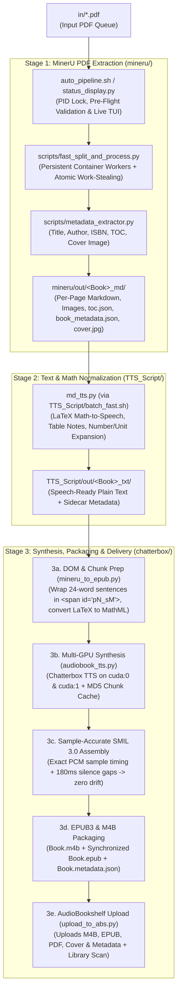

# BookConverters: Automated PDF-to-Audiobook & Synchronized EPUB3 Pipeline

**BookConverters** is an end-to-end, multi-GPU document conversion and audiobook synthesis suite. Drop a PDF (born-digital or scanned) into [`in/`](in/), and the pipeline automatically extracts structured layout, equations, images, and metadata, normalizes technical prose and LaTeX math into natural spoken English, synthesizes a chapter-indexed **`.m4b` audiobook** alongside a **synchronized read-along `.epub` (EPUB3 with SMIL 3.0 Media Overlays and W3C MathML)**, and uploads the unified package directly to **AudioBookshelf**.

---

## Table of Contents

1. [System Architecture & How Everything Works](#1-system-architecture--how-everything-works)
   - [High-Level Pipeline Flow](#high-level-pipeline-flow)
   - [Top-Level Orchestrator (`auto_pipeline.sh` / `auto_convert.sh`)](#top-level-orchestrator-auto_pipelinesh--auto_convertsh)
   - [Live Telemetry & Status Supervisor (`status_display.py`)](#live-telemetry--status-supervisor-status_displaypy)
   - [Stage 1: MinerU PDF Extraction & Metadata (`mineru/`)](#stage-1-mineru-pdf-extraction--metadata-mineru)
   - [Stage 2: Markdown & LaTeX Math Preprocessor (`TTS_Script/`)](#stage-2-markdown--latex-math-preprocessor-tts_script)
   - [Stage 3: Chatterbox TTS, Synchronized EPUB3 & AudioBookshelf (`chatterbox/`)](#stage-3-chatterbox-tts-synchronized-epub3--audiobookshelf-chatterbox)
   - [Alternative Engine: Kokoro-82M TTS (`kokoro/`)](#alternative-engine-kokoro-82m-tts-kokoro)
2. [Repository Structure](#2-repository-structure)
3. [Deployment Guide (Fresh `git clone` / `git pull`)](#3-deployment-guide-fresh-git-clone--git-pull)
   - [Step 1: System & OS Prerequisites](#step-1-system--os-prerequisites)
   - [Step 2: Podman GPU Passthrough (NVIDIA CDI)](#step-2-podman-gpu-passthrough-nvidia-cdi)
   - [Step 3: Clone Repository & Initialize Ignored Directories](#step-3-clone-repository--initialize-ignored-directories)
   - [Step 4: Python Virtual Environments & Chatterbox Repo Setup](#step-4-python-virtual-environments--chatterbox-repo-setup)
   - [Step 5: Provision Voice Cloning References (`.wav`)](#step-5-provision-voice-cloning-references-wav)
   - [Step 6: Build MinerU Containers & Download Models](#step-6-build-mineru-containers--download-models)
   - [Step 7: Configure Environment & AudioBookshelf](#step-7-configure-environment--audiobookshelf)
4. [Running the Pipeline](#4-running-the-pipeline)
   - [End-to-End Automated Conversion](#end-to-end-automated-conversion)
   - [Running Individual Stages Standalone](#running-individual-stages-standalone)
   - [Unattended CRON Automation](#unattended-cron-automation)
5. [Verification & Testing](#5-verification--testing)
6. [Troubleshooting](#6-troubleshooting)

---

## 1. System Architecture & How Everything Works

### High-Level Pipeline Flow



---

### Top-Level Orchestrator ([`auto_pipeline.sh`](auto_pipeline.sh) / [`auto_convert.sh`](auto_convert.sh))

[`auto_pipeline.sh`](auto_pipeline.sh) (aliased via symlink [`auto_convert.sh`](auto_convert.sh)) manages the lifecycle of every book from ingestion to archive:

1. **PID Concurrency Lock (`logs/auto_pipeline.lock`)**: Guarantees that manual runs and recurring CRON jobs never overlap or collide over GPU VRAM. If an instance is already running, subsequent triggers exit cleanly (`exit 0`). Stale locks from dead PIDs are automatically cleaned up.
2. **Pre-Flight File Validation**:
   - Ignores dotfiles (`.`) and macOS AppleDouble files (`._*`).
   - Quarantines 0-byte or non-PDF files (validates `%PDF` magic bytes) to [`failed/`](failed/) and logs to `logs/pipeline_failures.txt`.
   - **Write-Stability Sampling**: Samples file size across a 2-second window before ingesting to ensure large PDFs currently being copied over the network or disk are not moved mid-transfer.
3. **Automatic Backlog Draining**: Before pulling new PDFs from [`in/`](in/), the pipeline checks [`TTS_Script/out/`](TTS_Script/out/) and [`mineru/out/`](mineru/out/) to finish any books that already completed Stage 1 or Stage 2 in an earlier interrupted run (can be bypassed with `--no-drain`).
4. **Sequential Single-Book Execution**: Processes one book at a time through Stage 1 &rarr; Stage 2 &rarr; Stage 3 &rarr; AudioBookshelf upload so finished books appear in AudioBookshelf immediately and intermediate disk usage stays bounded.

---

### Live Telemetry & Status Supervisor ([`status_display.py`](status_display.py))

When [`auto_pipeline.sh`](auto_pipeline.sh) runs interactively, it automatically launches [`status_display.py`](status_display.py) as its supervisor process:

- **7-Stage Granular Progress Tracking**: Tracks progress across `1. PDF Extract (MinerU)`, `2. Text Clean & Math (md_tts)`, `3a. DOM & Chunk Prep`, `3b. TTS Synthesis (Chatterbox)`, `3c. Audio & SMIL Assembly`, `3d. EPUB3 & M4B Encode/Mux`, and `3e. AudioBookshelf Upload`.
- **Rolling-Window Throughput & ETA**: Computes both active stage ETA and overall book ETA using a 60-second rolling throughput window combined with per-stage page weights.
- **Real-Time Hardware Telemetry**: Background daemon thread polls GPUs via `pynvml` (with `nvidia-smi` fallback) for VRAM usage, GPU utilization, temperature, power draw, SM clocks, and hardware/thermal throttle bitmasks, alongside host CPU, RAM, and free disk space on the output volume.
- **Unattended / Non-TTY Mode (`--plain`)**: Emits structured single-line timestamped events and periodic `[HEARTBEAT]` summaries for CRON logs while teeing full output to `logs/<YYYYMMDD_HHMMSS>.log`.

---

### Stage 1: MinerU PDF Extraction & Metadata ([`mineru/`](mineru/))

Orchestrated by [`mineru/batch_fast.sh`](mineru/batch_fast.sh) and [`mineru/scripts/fast_split_and_process.py`](mineru/scripts/fast_split_and_process.py):

- **Persistent Container Workers & Atomic Work-Stealing**: Instead of spawning a cold container per page (which incurs an ~11s Python/PyTorch import penalty per page), `fast_split_and_process.py` keeps persistent worker containers (`mineru-fast-w0`, `mineru-fast-w1`) running [`process_pages_worker.py`](mineru/scripts/process_pages_worker.py). Workers dynamically claim pages via atomic lockfiles in `out/<book>_pages/.claims/`.
- **Auto-Detection of Digital vs. Scanned PDFs**:
  - **Born-Digital PDFs (`--method txt`)**: Uses YOLOv8 layout detection + `pdfium` direct glyph extraction for 100% character fidelity on code blocks, equations, and prose.
  - **Scanned PDFs (`--method ocr` or `--backend vlm-http-client`)**: Uses optical character recognition or dual-GPU `llama.cpp` VLM servers (`MinerU2.5-2509-1.2B-GGUF` on ports `30000` and `30001`).
- **Autoregressive Loop Collapser & Multi-Pass Retries**: Automatically detects and collapses VLM token-repetition loops, preserves intentional spacer pages with `<!-- blank page -->`, and restarts `llama.cpp` servers between retry passes to flush KV-cache state on truncated pages.
- **Bibliographic Metadata & Cover Extraction ([`metadata_extractor.py`](mineru/scripts/metadata_extractor.py))**:
  - Combines filename heuristics, `pdfinfo` tags, and front-matter inspection (first 12 pages) to extract **Title**, **Subtitle**, **Authors**, **Publisher**, **Publication Year**, **ISBN**, **Series**, **Genres**, and **Description**.
  - Extracts the PDF outline/bookmarks into `toc.json` and renders Page 1 to `cover.jpg` via `pdftoppm`.
  - Writes `<book>_md/book_metadata.json`, `toc.json`, and `cover.jpg`.

---

### Stage 2: Markdown & LaTeX Math Preprocessor ([`TTS_Script/`](TTS_Script/))

Orchestrated by [`TTS_Script/batch_fast.sh`](TTS_Script/batch_fast.sh) and [`TTS_Script/md_tts.py`](TTS_Script/md_tts.py):

- **LaTeX Math-to-Speech**:
  - Resolves single-letter variables (`$x$`), Greek letters (`$\alpha$`), and simple subscripts (`$w_0$`) in-memory via a fast-path cache.
  - Sends complex inline/block LaTeX equations to a local Speech Rule Engine container (`mathspeak-api` on port `8099`) or, if offline, automatically uses a comprehensive built-in local LaTeX verbalizer (e.g., `\frac{a}{b}` &rarr; *"a over b"*, `\sqrt{x}` &rarr; *"the square root of x"*).
- **Table & Code Block Handling**: Replaces Markdown pipe tables, grid tables, MyST tables, and HTML tables with spoken references (`See table <Name>.`) instead of reading raw table cells aloud; strips or placeholders code blocks.
- **Number, Currency, Unit & Abbreviation Normalization**: Uses `num2words` and regex rules to expand currencies (`$5.50` &rarr; *"five dollars and fifty cents"*), attached units (`16GB` &rarr; *"sixteen gigabytes"*, `3.2GHz` &rarr; *"three point two gigahertz"*), ranges (`10-20` &rarr; *"ten to twenty"*), and scholarly abbreviations (`e.g.` &rarr; *"for example,"*, `et al.` &rarr; *"and colleagues,"*, `Fig.` &rarr; *"Figure"*) so the TTS sentence splitter never breaks mid-sentence.
- **Sidecar Forwarding**: Copies `book_metadata.json`, `toc.json`, and `cover.jpg` into `TTS_Script/out/<book>_txt/` and archives the raw Markdown folder to `TTS_Script/completed/`.

---

### Stage 3: Chatterbox TTS, Synchronized EPUB3 & AudioBookshelf ([`chatterbox/`](chatterbox/))

Orchestrated by [`chatterbox/batch_fast.sh`](chatterbox/batch_fast.sh), [`chatterbox/audiobook_tts.py`](chatterbox/audiobook_tts.py), [`chatterbox/mineru_to_epub.py`](chatterbox/mineru_to_epub.py), and [`chatterbox/upload_to_abs.py`](chatterbox/upload_to_abs.py):

1. **Dual-Stream DOM & Sentence Chunking (`mineru_to_epub.py`)**:
   - Parses the rich MinerU Markdown (preserving images, tables, and converting LaTeX formulas to native W3C **MathML 3** via `latex2mathml`).
   - Splits prose into ADHD-optimized ~24-word single-sentence chunks (`CHUNK_SIZE_WORDS = 24` in [`chatterbox/config.py`](chatterbox/config.py)), wrapping each visual chunk in `<span id="p{page}_s{seq}">...</span>` inside `OEBPS/text/page_{num}.xhtml` while pairing it with its normalized spoken string for TTS.
2. **Multi-GPU Chatterbox TTS Synthesis (`audiobook_tts.py`)**:
   - Spawns parallel worker processes across `cuda:0` and `cuda:1` running Resemble AI's **Chatterbox TTS** (`standard` 500M or `turbo` 350M model at 24 kHz) with zero-shot voice cloning.
   - Trims leading/trailing dead air from each synthesized chunk and caches every WAV chunk by MD5 hash in `chatterbox/cache/audio_chunks/` for instant resume.
   - Automatically shuts down GPU workers and frees VRAM before FFmpeg encoding begins.
3. **Sample-Accurate SMIL 3.0 Media Overlays & Audio Assembly**:
   - Computes exact `clipBegin` and `clipEnd` timestamps directly from raw 24 kHz PCM sample counts (`len(samples) / 24000`) plus `180ms` inter-chunk silence padding before any lossy encoding, guaranteeing **zero timing drift** across multi-hour books.
   - Generates per-page MP3 audio (`OEBPS/audio/page_{num}.mp3`) and SMIL overlay files (`OEBPS/smil/page_{num}.smil`) for synchronized sentence highlighting in EPUB3 readers.
4. **Unified Chapter Naming (`Page N: Chapter Title`)**:
   - Maps `toc.json` entries to pages so both the `.epub` navigation (`nav.xhtml`) and `.m4b` FFmpeg chapter markers share identical titles (`Page 4: I. About This Book`, or `Page 12` when no heading starts on that page).
5. **AudioBookshelf Upload (`upload_to_abs.py`)**:
   - Uploads `<Book>.m4b`, `<Book>.epub`, companion `<Book>.pdf`, `<Book>.metadata.json`, and `<Book>.cover.jpg` to `/api/upload` on your AudioBookshelf server and triggers a library scan.

---

### Alternative Engine: Kokoro-82M TTS ([`kokoro/`](kokoro/))

For ultra-fast single-GPU or CPU synthesis without voice cloning, [`kokoro/`](kokoro/) provides a standalone toolkit built around [Kokoro-82M](https://huggingface.co/hexgrad/Kokoro-82M) with 50+ built-in voices (`af_heart`, `am_michael`, `bf_emma`, etc.), paired with its own [`audiobook_tts.py`](kokoro/audiobook_tts.py), [`mineru_to_epub.py`](kokoro/mineru_to_epub.py), and [`upload_to_abs.py`](kokoro/upload_to_abs.py).

---

## 2. Repository Structure

```text
BookConverters/
├── auto_pipeline.sh              # Master 3-stage pipeline orchestrator (PID lock, validation, backlog drain)
├── auto_convert.sh               # Convenience symlink -> auto_pipeline.sh
├── status_display.py             # Rich live TUI dashboard, GPU/host telemetry poller, and ETA engine
├── compose.yaml                  # Top-level Podman compose reference for MinerU services
├── requirements.txt              # Root Python environment dependencies (Kokoro, MinerU, TTS_Script, EPUB)
├── cron_example.txt              # Sample crontab schedules for unattended execution
├── in/                           # [git-ignored] Drop input PDFs here for automatic conversion
├── completed/                    # [git-ignored] Hardlinked/archived source PDFs after full completion
├── failed/                       # [git-ignored] Quarantined corrupt or failed PDFs
├── logs/                         # [git-ignored] Timestamped run logs, lockfile, and failure reports
│
├── mineru/                       # STAGE 1: PDF Layout, OCR, VLM & Metadata Extraction
│   ├── batch_fast.sh             # Batch driver for Stage 1
│   ├── compose.yaml              # Podman services: mineru-batch, mineru-api, llamacpp (GPU 0 & GPU 1)
│   ├── Dockerfile.cpu            # Slim MinerU image with pipeline & VLM HTTP client backends
│   ├── Containerfile.llamacpp    # Builds llama.cpp with CUDA sm_60 (Pascal) support
│   ├── Deploy.md                 # Deep-dive hardware & container deployment guide
│   └── scripts/
│       ├── fast_split_and_process.py  # Dual-GPU persistent worker orchestrator
│       ├── process_pages_worker.py    # In-container worker loop with atomic work-stealing
│       └── metadata_extractor.py      # Deterministic bibliographic metadata, TOC & cover extractor
│
├── TTS_Script/                   # STAGE 2: Markdown, MyST & LaTeX Math-to-Speech Preprocessor
│   ├── batch_fast.sh             # Batch driver for Stage 2
│   ├── md_tts.py                 # AST-based Markdown cleaner, table handler & LaTeX verbalizer
│   ├── stream_worker.py          # Streaming directory watcher for concurrent OCR + text cleaning
│   └── requirements.txt          # Stage 2 Python dependencies
│
├── chatterbox/                   # STAGE 3: Chatterbox TTS, Synchronized EPUB3 (SMIL) & ABS Upload
│   ├── batch_fast.sh             # Batch driver for Stage 3
│   ├── audiobook_tts.py          # Multi-GPU Chatterbox TTS synthesizer & M4B chapter muxer
│   ├── mineru_to_epub.py         # EPUB3 + MathML + SMIL 3.0 Media Overlay builder
│   ├── upload_to_abs.py          # AudioBookshelf multi-file API uploader (M4B + EPUB + PDF + Cover)
│   ├── config.py                 # Voice, chunking (24 words), sampling & device settings
│   ├── verify_epub3_smil.py      # End-to-end verification suite for SMIL timing & EPUB3 compliance
│   ├── check_gpus.py             # GPU VRAM & process diagnostic utility
│   ├── requirements.txt          # Stage 3 Python dependencies
│   ├── chatterbox_repo/          # [git-ignored] Cloned Resemble AI Chatterbox source package
│   └── references/               # Zero-shot voice cloning reference folders (.wav files git-ignored)
│
├── kokoro/                       # Alternative lightweight TTS pipeline using Kokoro-82M
│   ├── audiobook_tts.py          # Kokoro-82M synthesizer
│   ├── mineru_to_epub.py         # EPUB3 converter
│   ├── upload_to_abs.py          # AudioBookshelf uploader
│   └── config.py                 # Kokoro voice & speed settings
│
└── tests/
    └── test_status_display.py    # Unit tests for rolling ETA, telemetry & status display
```

---

## 3. Deployment Guide (Fresh `git clone` / `git pull`)

Because [`.gitignore`](.gitignore) intentionally excludes virtual environments (`.venv/`), model weights (`models/`), runtime queues (`in/`, `out/`, `completed/`, `failed/`, `logs/`), the upstream `chatterbox_repo/` clone, and audio files (`**/*.wav`), follow the steps below after cloning or pulling the repository onto a new machine.

### Step 1: System & OS Prerequisites

Install required host packages on Ubuntu / Debian:

```bash
sudo apt-get update
sudo apt-get install -y \
  git curl wget build-essential \
  python3 python3-venv python3-pip \
  ffmpeg espeak-ng poppler-utils \
  podman podman-compose nvidia-container-toolkit
```

* **`ffmpeg`**: Required for `.m4b` AAC encoding, chapter metadata muxing, and EPUB3 MP3 audio encoding.
* **`poppler-utils`**: Provides `pdfinfo` (page count & PDF metadata) and `pdftoppm` (cover image rendering).
* **`espeak-ng`**: Phonemizer fallback for Kokoro TTS.
* **`podman` & `podman-compose`**: Runs the isolated MinerU extraction and `llama.cpp` VLM containers.

---

### Step 2: Podman GPU Passthrough (NVIDIA CDI)

Rootless Podman uses the Container Device Interface (CDI) to access NVIDIA GPUs. Generate the CDI specification once (and repeat after any NVIDIA driver upgrade):

```bash
sudo nvidia-ctk cdi generate --output=/etc/cdi/nvidia.yaml
nvidia-ctk cdi list
```

Verify that Podman can see your GPUs:

```bash
podman run --rm --device nvidia.com/gpu=all --security-opt label=disable \
  nvidia/cuda:12.4.1-base-ubuntu22.04 nvidia-smi
```

> [!TIP]
> **Container Storage Location**: MinerU images and model volumes require ~15–20 GB. If your root filesystem (`/`) is small, point Podman's `graphroot` in `/etc/containers/storage.conf` to your large data array (e.g., `/mnt/raid0/containers/storage`) before building images.

---

### Step 3: Clone Repository & Initialize Ignored Directories

```bash
git clone git@github.com:jigglytep/BookConverter.git BookConverters
cd BookConverters

# Create runtime directories excluded by .gitignore
mkdir -p in completed failed logs models/gguf \
  mineru/in mineru/out mineru/completed mineru/models/gguf \
  TTS_Script/out TTS_Script/completed \
  chatterbox/audiobooks chatterbox/chunks chatterbox/cache/audio_chunks chatterbox/completed chatterbox/logs \
  chatterbox/references/default chatterbox/references/practical_engineering
```

---

### Step 4: Python Virtual Environments & Chatterbox Repo Setup

The repository uses a primary virtual environment at `.venv/` (and optionally a dedicated `chatterbox/.venv/` if isolating dependencies, though a unified `.venv` at the root is automatically detected by all scripts).

> [!IMPORTANT]
> **Hardware Note for NVIDIA Pascal GPUs (Tesla P100 / SM 6.0)**:
> PyTorch dropped Pascal (`sm_60` / `sm_61`) kernels in CUDA 12.8+ wheels. Both [`requirements.txt`](requirements.txt) and [`chatterbox/requirements.txt`](chatterbox/requirements.txt) pin `--extra-index-url https://download.pytorch.org/whl/cu126` so `sm_60` kernels are preserved. On newer GPUs (Ampere/Ada/Hopper), `cu126` also works out of the box.

#### 4.1 Create the Root `.venv`
```bash
python3 -m venv .venv
source .venv/bin/activate
pip install --upgrade pip wheel setuptools

# Install root, TTS_Script, and Chatterbox dependencies
pip install -r requirements.txt
pip install -r TTS_Script/requirements.txt
pip install -r chatterbox/requirements.txt
```

#### 4.2 Clone `chatterbox_repo` (Ignored by Git)
[`chatterbox/audiobook_tts.py`](chatterbox/audiobook_tts.py) imports the `chatterbox` package directly from `chatterbox/chatterbox_repo/src`. Because `chatterbox_repo/` is git-ignored, clone it into `chatterbox/chatterbox_repo`:

```bash
git clone https://github.com/resemble-ai/chatterbox.git chatterbox/chatterbox_repo
```

*(Optional)* If you prefer an isolated virtual environment specifically for Stage 3 (`chatterbox/.venv`), you can also create one:
```bash
python3 -m venv chatterbox/.venv
chatterbox/.venv/bin/pip install --upgrade pip
chatterbox/.venv/bin/pip install -r chatterbox/requirements.txt
```

---

### Step 5: Provision Voice Cloning References (`.wav`)

Because `**/*.wav` is in [`.gitignore`](.gitignore#L68), reference voice audio files are not tracked in git.

By default, [`chatterbox/config.py`](chatterbox/config.py) sets `DEFAULT_REFERENCE_ID = "practical_engineering"`.
1. Place a clean 10–30 second mono/stereo `.wav` voice sample inside `chatterbox/references/practical_engineering/practical_engineering.wav` (and/or `chatterbox/references/default/default.wav`).
2. Or change `DEFAULT_REFERENCE_ID` in [`chatterbox/config.py`](chatterbox/config.py#L19) to match your custom folder name under `chatterbox/references/<your_voice_id>/`.
3. Verify detected reference voices at any time:
   ```bash
   .venv/bin/python3 chatterbox/audiobook_tts.py --list-references
   ```

---

### Step 6: Build MinerU Containers & Download Models

#### 6.1 Configure `mineru/.env`
Create `mineru/.env` with your hardware settings:

```ini
IN_DIR=./in
OUT_DIR=./out
GGUF_DIR=./models/gguf

MINERU_THREADS=10
MINERU_METHOD=auto
MINERU_MODEL_SOURCE=huggingface

# VLM / llama.cpp settings (for scanned/complex layout VLM mode)
CUDA_ARCH=60
GPU_IDS=0
VLM_PORT=30000
GGUF_FILE=MinerU2.5-2509-1.2B-q8_0.gguf
MMPROJ_FILE=MinerU2.5-2509-1.2B-q8_0.mmproj
VLM_MODEL_NAME=MinerU2.5-2509-1.2B
VLM_URL=http://llamacpp:30000
MINERU_TASK_RESULT_TIMEOUT_SECONDS=43200
MINERU_API_MAX_CONCURRENT_REQUESTS=1
MINERU_VIRTUAL_VRAM_SIZE=12
```

#### 6.2 Build the MinerU Image
```bash
cd mineru
podman compose --profile batch build
```
*(On its first run, MinerU automatically downloads its layout/OCR models into the persistent `mineru_mineru-models` named volume).*

#### 6.3 (Optional) Build the Dual-GPU `llama.cpp` VLM Image & Download GGUF Weights
If you plan to run `--backend vlm-http-client` or `--backend hybrid-http-client`:

```bash
# Download the Q8_0 model and multimodal vision projector (~1.5 GB total)
 ../.venv/bin/huggingface-cli download Mungert/MinerU2.5-2509-1.2B-GGUF \
  MinerU2.5-2509-1.2B-q8_0.gguf MinerU2.5-2509-1.2B-q8_0.mmproj \
  --local-dir ./models/gguf

# Build llama.cpp container (compiles CUDA kernels for CUDA_ARCH, takes ~10-15 mins)
podman compose --profile vlm build llamacpp

# Start the VLM server(s)
podman compose --profile vlm up -d llamacpp
cd ..
```

#### 6.4 (Optional) MathSpeak Speech Rule Engine Container
Stage 2 (`TTS_Script/batch_fast.sh`) checks `http://localhost:8099/healthz` for a `mathspeak-api` container to convert complex LaTeX via MathJax SRE.
- If a Podman container named `mathspeak-api` exists, `batch_fast.sh` automatically starts it.
- **No action is required if you don't run `mathspeak-api`**: [`TTS_Script/md_tts.py`](TTS_Script/md_tts.py) includes a built-in offline LaTeX verbalizer fallback that converts equations into spoken English locally without external services.

---

### Step 7: Configure Environment & AudioBookshelf

Stage 3 automatically uploads finished books to AudioBookshelf via [`chatterbox/upload_to_abs.py`](chatterbox/upload_to_abs.py). Configure your server connection by creating `chatterbox/.env` (or exporting environment variables):

```ini
ABS_SERVER=http://your-audiobookshelf-host:3378
ABS_USERNAME=your_username
ABS_PASSWORD=your_password
# Or use an API token instead of username/password:
# ABS_TOKEN=your_abs_api_token
ABS_LIBRARY=TTS
ABS_SCAN=true
```

> [!NOTE]
> If you passed a different clone directory path than `/path/to/BookConverters`, all orchestrator scripts (`auto_pipeline.sh`, `mineru/batch_fast.sh`, `TTS_Script/batch_fast.sh`, `chatterbox/batch_fast.sh`) dynamically resolve their relative paths via `BASH_SOURCE[0]` or `VENV_PATH`. You can optionally export `VENV_PATH="/path/to/BookConverters/.venv/bin/activate"` in your shell profile.

---

## 4. Running the Pipeline

### End-to-End Automated Conversion

1. **Drop one or more PDFs into `in/`**:
   ```bash
   cp /path/to/MyBook.pdf in/
   ```
2. **Preview the queue (Dry Run)**:
   ```bash
   ./auto_convert.sh --dry-run
   ```
3. **Run the full pipeline (launches the live Rich dashboard)**:
   ```bash
   ./auto_convert.sh
   ```

#### Common Pipeline Options (`./auto_convert.sh --help`)

| Flag / Option | Description |
| :--- | :--- |
| `./auto_convert.sh` | Process any unfinished backlog in `mineru/out` & `TTS_Script/out`, then convert all PDFs in `in/`. |
| `./auto_convert.sh in/Book.pdf` | Convert a single specific PDF file. |
| `-n`, `--dry-run` | Preview pending backlog and `in/` queue without moving files or executing stages. |
| `-c`, `--clean` | Clear all in-progress artifacts (`mineru/in`, `mineru/out`, `TTS_Script/out`), intermediate chunks, and TTS audio cache. |
| `--no-drain` | Skip backlog draining and immediately process `in/`. |
| `--force` | Force full re-conversion even if `chatterbox/audiobooks/<Book>.m4b` already exists. |
| `--model {standard,turbo}` | Select Chatterbox TTS architecture (`standard` 500M default, or `turbo` 350M). |
| `--reference-id <id>` | Override voice cloning reference preset (e.g. `practical_engineering`, `default`). |
| `--reference-audio <wav>` | Path to a custom `.wav` file for zero-shot voice cloning. |
| `--workers <N>` | Number of parallel MinerU worker containers in Stage 1 (default: `2`). |
| `--library <name>` | Target AudioBookshelf library name (default: `TTS`). |
| `--skip-upload` | Generate `.m4b` and `.epub` locally in `chatterbox/audiobooks/` without uploading to AudioBookshelf. |
| `--skip-epub` | Synthesize `.m4b` audiobook only, skipping EPUB3 generation. |
| `--skip-pdf` | Do not include the source `.pdf` when uploading to AudioBookshelf. |
| `--plain` | Non-TTY / unattended output mode (line-per-event + periodic `[HEARTBEAT]` lines). |
| `--demo` | Launch the live TUI dashboard with simulated books and GPU telemetry (no GPU load). |

---

### Running Individual Stages Standalone

Each stage can be executed independently for debugging or custom workflows:

#### Stage 1 Only (PDF &rarr; Markdown + Metadata + Cover)
```bash
cd mineru
# Single PDF with dual-GPU persistent workers:
../.venv/bin/python3 scripts/fast_split_and_process.py in/Book.pdf --workers 2

# Or batch process everything in mineru/in/:
./batch_fast.sh
```

#### Stage 2 Only (Markdown &rarr; Clean Speech-Ready Text)
```bash
cd TTS_Script
# Process all *_md folders in ../mineru/out/:
./batch_fast.sh

# Or convert a single Markdown file/directory directly:
../.venv/bin/python3 md_tts.py ../mineru/out/Book_md -o out/Book_txt --recursive --numbers words
```

#### Stage 3 Only (Text/Markdown &rarr; M4B + Synchronized EPUB3 + AudioBookshelf)
```bash
cd chatterbox
# Process all *_txt folders in ../TTS_Script/out/:
./batch_fast.sh

# Or run audiobook_tts.py directly on a folder:
../.venv/bin/python3 audiobook_tts.py ../TTS_Script/out/Book_txt \
  -o audiobooks/Book.m4b \
  --epub-output audiobooks/Book.epub \
  --markdown-dir ../TTS_Script/completed/Book_md \
  --devices "cuda:0,cuda:1"

# Upload existing artifacts to AudioBookshelf (dry-run preview first):
../.venv/bin/python3 upload_to_abs.py audiobooks/Book.m4b --dry-run
../.venv/bin/python3 upload_to_abs.py audiobooks/Book.m4b --scan
```

---

### Unattended CRON Automation

Because [`auto_pipeline.sh`](auto_pipeline.sh) uses a strict PID lockfile (`logs/auto_pipeline.lock`), you can schedule it every 15–30 minutes via `crontab -e`. If a previous book is still converting on the GPUs, overlapping CRON triggers exit immediately with code `0`.

```cron
# Check in/ every 30 minutes and convert any new PDFs
*/30 * * * * /path/to/BookConverters/auto_pipeline.sh --plain >> /path/to/BookConverters/logs/cron.log 2>&1
```

See [`cron_example.txt`](cron_example.txt) for additional schedule templates.

---

## 5. Verification & Testing

Run the built-in test suites to verify your installation after a fresh pull:

```bash
# 1. Test the live status display UI using simulated GPU telemetry (5 seconds):
./auto_convert.sh --demo --demo-duration 5

# 2. Run unit tests for ETA calculation, rolling throughput, and telemetry formatting:
.venv/bin/python3 -m unittest tests/test_status_display.py

# 3. Verify GPU visibility and VRAM status for Chatterbox:
.venv/bin/python3 chatterbox/check_gpus.py

# 4. Run the EPUB3 + SMIL 3.0 Media Overlay + M4B verification suite (if sample book present):
.venv/bin/python3 chatterbox/verify_epub3_smil.py
```

---

## 6. Troubleshooting

| Symptom | Cause | Resolution |
| :--- | :--- | :--- |
| **`Another pipeline instance is actively running (PID: ...)`** | A conversion is currently active, or a previous run was `SIGKILL`ed. | If the PID is dead, `auto_pipeline.sh` removes the stale lock automatically. To check manually: `ps -p $(cat logs/auto_pipeline.lock)`. |
| **`ModuleNotFoundError: No module named 'chatterbox'`** | `chatterbox/chatterbox_repo` is missing (ignored by git). | Clone it: `git clone https://github.com/resemble-ai/chatterbox.git chatterbox/chatterbox_repo`. |
| **Voice cloning warning / missing reference audio** | `**/*.wav` files are git-ignored on a fresh clone. | Place a `.wav` voice reference in `chatterbox/references/practical_engineering/` or pass `--reference-audio /path/to/voice.wav`. |
| **Podman container reports `no CUDA-capable device is detected`** | NVIDIA CDI specification is missing or outdated after a driver update. | Run `sudo nvidia-ctk cdi generate --output=/etc/cdi/nvidia.yaml`. |
| **`CUDA error: no kernel image is available for execution on the device` on Tesla P100** | Unpinned PyTorch installed `cu128` wheels (which dropped SM 6.0 Pascal). | Reinstall PyTorch from the `cu126` index: `.venv/bin/pip install --force-reinstall torch==2.7.1+cu126 torchaudio==2.7.1+cu126 --extra-index-url https://download.pytorch.org/whl/cu126`. |
| **Need to reset a stuck/interrupted conversion and clear cached audio chunks** | Leftover intermediate folders in `mineru/out`, `TTS_Script/out`, or `chatterbox/chunks`. | Run `./auto_convert.sh --clean` (add `--dry-run` first to preview what will be deleted). |
| **Stage 1 VLM server truncates a dense page repeatedly** | Greedy decoding (`temp=0`) replays the same state without a KV-cache reset. | `fast_split_and_process.py` automatically restarts `llamacpp` between retry passes. To reset manually: `podman restart llamacpp llamacpp1`. |
